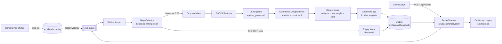

# Architecture

## Folders
| Path | What lives there |
|---|---|
| `src/backend/` | FastAPI server, SQLite layer, risk scoring, message writer, the real ML pipeline, import helper |
| `src/frontend/` | The five pages (Home, Upload, Alerts, Analytics, Model accuracy), `api.js` data layer, page runtime |
| `src/ml/` | Offline scripts that produced the species model and measured it |
| `src/config.yaml` | Thresholds, risk weights, camera layout, census figures |
| `src/reports/` | `metrics.json` and `model_selection.md`: the only source of the Model accuracy page |
| `tests/` | API, upload, persistence and Playwright browser tests |
| `docs/` | This file, the database schema, evaluation notes |

## Decisions worth explaining to judges
* **Detector and classifier are separate.** MegaDetector says where an animal is; a second model says which species. Each can be
  replaced without touching the other.
* **Missing an animal is worse than a false alarm.** A frame is discarded only when MegaDetector is nearly certain it is empty
  (best box below 0.05). Doubtful frames (0.05 to 0.30) go to a review queue and still raise an alert.
* **No invented numbers.** Every figure on the dashboard comes from the database, `src/reports/` or `src/config.yaml`; anything
  never measured shows "Not measured".
